# Mini-CMS

Projet fil rouge de l'Atelier Framework Côté Serveur (Laravel 13, PHP 8.3+), 3e année MDW, ISET Sidi Bouzid.

Auteur : Dhia Mastouri, groupe MDW32.

## Description

Mini-CMS est une petite plateforme de publication d'articles construite séance par séance : un site public (articles, catégories, tags, archives), un back-office réservé aux administrateurs, une authentification écrite à la main avec rôles et autorisations, et une API JSON protégée par des jetons Laravel Sanctum. Chaque fonctionnalité est couverte par des tests Pest. Chaque session se termine par un tag Git (`lab-01` à `lab-08b`).

## Fonctionnalités

### Site public

- Liste paginée des articles publiés, page d'un article avec ses tags et les articles de la même catégorie.
- Pages par catégorie (`/posts/categorie/{slug}`), par tag (`/posts/tag/{slug}`) et par année (`/posts/archive/{year}`).
- Accueil avec les derniers articles, les catégories et les tags populaires (comptés avec `withCount`).
- Pages d'erreur 403, 404 et 503 dans le layout du site, pages « Article introuvable » et « Catégorie introuvable ».

### Authentification et autorisations

- Inscription, connexion (avec « Se souvenir de moi ») et déconnexion écrites à la main (`Hash::make()`, `Auth::attempt()`, régénération de la session).
- Rôles `author` et `admin` : middleware `admin` sur tout `/admin`, Gates `manage-categories` et `manage-tags`, `PostPolicy` (un auteur gère ses articles, un admin tous), `Gate::before` pour les admins.
- Brouillons visibles seulement par leur auteur et les admins (scope `visibleTo()` et `PostPolicy::view()`).
- Page « Mes articles » avec les brouillons de l'auteur connecté.

### Back-office

- CRUD des articles avec Form Requests (`StorePostRequest`, `UpdatePostRequest`), catégorie, tags (`sync()`), publication et messages flash.
- CRUD des catégories et des tags sous `/admin` ; supprimer une catégorie garde ses articles (`nullOnDelete()`).
- Gestion des rôles des utilisateurs (`/admin/utilisateurs`) : un admin ne peut pas changer son propre rôle.
- Mode lecture seule (`SITE_READ_ONLY=true`) : le middleware `writable` refuse toute écriture avec 503 et un bandeau prévient le visiteur.
- Messages de validation en français (`lang/fr/validation.php`).

### API JSON

- Lecture publique des articles (filtres `?category=`, `?tag=`, `?per_page=`), des catégories et des tags, avec des API Resources.
- Jetons Sanctum, écritures protégées par `auth:sanctum` et par les mêmes Form Requests et la même `PostPolicy` que le site.
- Collection Postman : `docs/postman/mini-cms.postman_collection.json`.

### Tests

- 100 tests Pest (`php artisan test`), dont `AuthTest`, `AuthorizationTest`, `AdminAccessTest`, `PostVisibilityTest`, `ApiReadTest`, `ApiWriteTest` et `TagApiTest`.

## Installation

Prérequis : PHP 8.3 ou plus (extensions curl, fileinfo, mbstring, openssl, pdo_sqlite, sqlite3 et zip activées dans php.ini), Composer, Node.js LTS avec npm, et Git. La base de données est un fichier SQLite.

### Bash

```bash
git clone https://github.com/mastouridhia/mini-cms.git
cd mini-cms
composer install
npm install
npm run build
cp .env.example .env
php artisan key:generate
php artisan migrate:fresh --seed
php artisan test
composer run dev
```

### PowerShell

```powershell
git clone https://github.com/mastouridhia/mini-cms.git
cd mini-cms
composer install
npm install
npm run build
copy .env.example .env
php artisan key:generate
php artisan migrate:fresh --seed
php artisan test
composer run dev
```

Si Laravel demande de créer `database/database.sqlite`, répondre `yes`. `npm run build` est nécessaire avant les tests et avant le premier affichage : sans lui, `@vite` échoue avec « Vite manifest not found ».

Ouvrir ensuite http://localhost:8000 (adresse de l'application, différente de l'adresse de Vite sur le port 5173).

## Comptes de test

Créés par `php artisan migrate:fresh --seed` :

| Compte | Mot de passe | Rôle |
|---|---|---|
| `test@example.com` | `password` | admin |
| deux comptes générés par `UserFactory` (adresses visibles dans `/admin/utilisateurs`) | `password` | author |

Un nouveau compte créé depuis `/inscription` a toujours le rôle `author`.

## API

Toutes les requêtes envoient l'en-tête `Accept: application/json`. Les réponses d'erreur des URL `api/*` sont toujours en JSON.

### Endpoints

| Méthode | URI | Accès | Réponse |
|---|---|---|---|
| GET | `/api/posts` | public | 200, articles publiés paginés (`data`, `links`, `meta`) ; filtres `?category=<slug>`, `?tag=<slug>`, `?per_page=1..50` |
| GET | `/api/posts/{post}` | public | 200 ; 403 pour un brouillon ; 404 si inconnu |
| POST | `/api/posts` | jeton | 201 ; l'auteur est l'utilisateur du jeton ; tags synchronisés |
| PUT | `/api/posts/{post}` | jeton + `PostPolicy` | 200 ; 403 si ce n'est pas votre article |
| DELETE | `/api/posts/{post}` | jeton + `PostPolicy` | 204 |
| GET | `/api/categories` | public | 200, avec `posts_count` (articles publiés) |
| GET | `/api/categories/{category}` | public | 200 ; 404 si inconnue |
| GET | `/api/tags` | public | 200, avec `posts_count` (articles publiés) |
| GET | `/api/tags/{tag}` | public | 200 ; 404 si inconnu |
| POST | `/api/login` | public | 201 avec `token` et `token_type` ; 422 si les identifiants sont faux |
| POST | `/api/logout` | jeton | 204, le jeton est révoqué |
| GET | `/api/user` | jeton | 200, l'utilisateur du jeton |

### Authentification par jeton

1. `POST /api/login` avec `{"email": "...", "password": "..."}` renvoie `{"token": "...", "token_type": "Bearer"}`.
2. Chaque requête protégée envoie l'en-tête `Authorization: Bearer VOTRE_JETON`.
3. `POST /api/logout` supprime le jeton utilisé : il renvoie ensuite 401.

Ne jamais publier un jeton (README, captures, collection Postman) : il donne accès au compte comme un mot de passe.

### Codes d'erreur

| Code | Cas |
|---|---|
| 401 | Aucun jeton, ou jeton révoqué (`{"message": "Unauthenticated."}`) |
| 403 | Brouillon d'un autre auteur, ou modification/suppression de l'article d'un autre auteur (`PostPolicy`) |
| 404 | Article, catégorie ou tag inconnu (route model binding) |
| 422 | Données invalides ou identifiants faux, messages en français dans `errors` |

### Exemple curl.exe

Sous PowerShell, taper `curl.exe` et non `curl` (qui lance `Invoke-WebRequest`). Avec Windows PowerShell 5.1, un JSON court s'écrit entre apostrophes avec des guillemets échappés `\"` ; un JSON qui contient des espaces est plus sûr dans un fichier envoyé avec `--data-binary "@fichier.json"` (PowerShell 5.1 coupe sinon l'argument aux espaces).

```powershell
curl.exe -s -X POST -H "Accept: application/json" -H "Content-Type: application/json" -d '{\"email\":\"test@example.com\",\"password\":\"password\"}' http://localhost:8000/api/login

'{"title":"Article via curl","slug":"article-via-curl","body":"Contenu assez long pour la validation.","is_published":true}' | Out-File -Encoding ascii article.json
curl.exe -s -X POST -H "Accept: application/json" -H "Content-Type: application/json" -H "Authorization: Bearer VOTRE_JETON" --data-binary "@article.json" http://localhost:8000/api/posts

curl.exe -i -X POST -H "Accept: application/json" -H "Authorization: Bearer VOTRE_JETON" http://localhost:8000/api/logout
```

La dernière commande renvoie `HTTP/1.1 204 No Content` sans corps.

## Captures d'écran

### Site


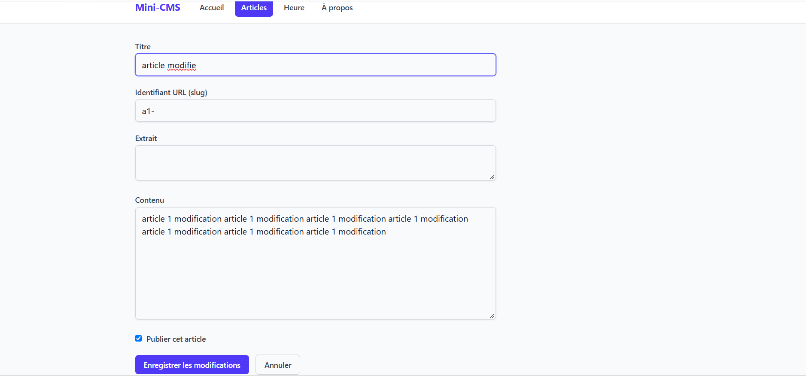

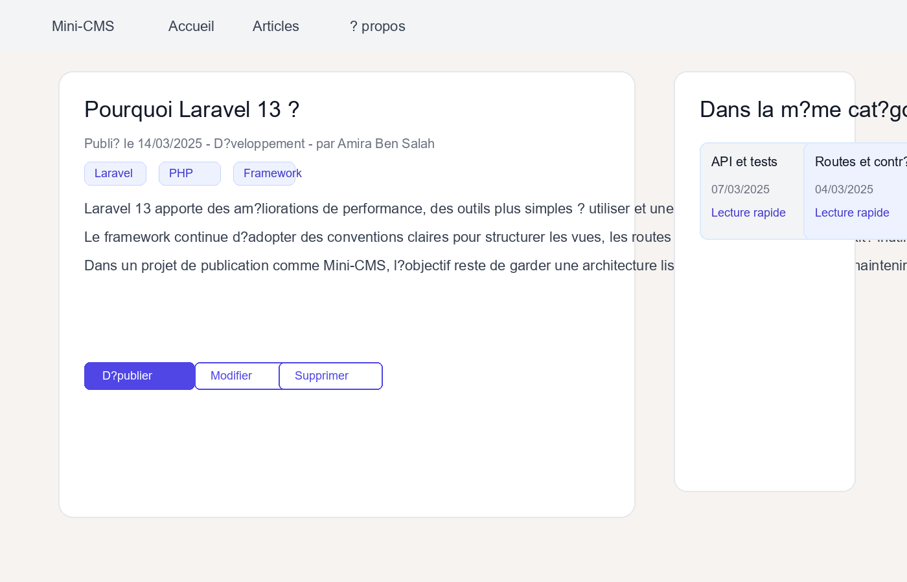

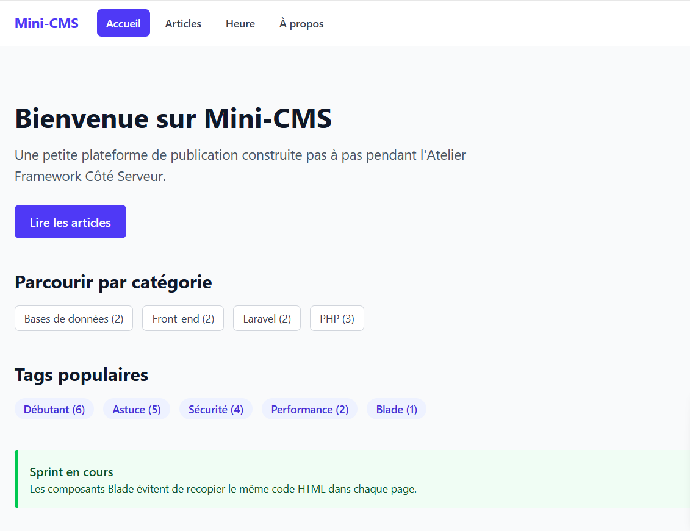

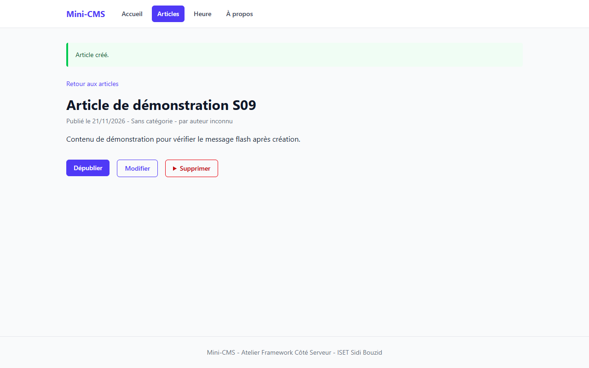

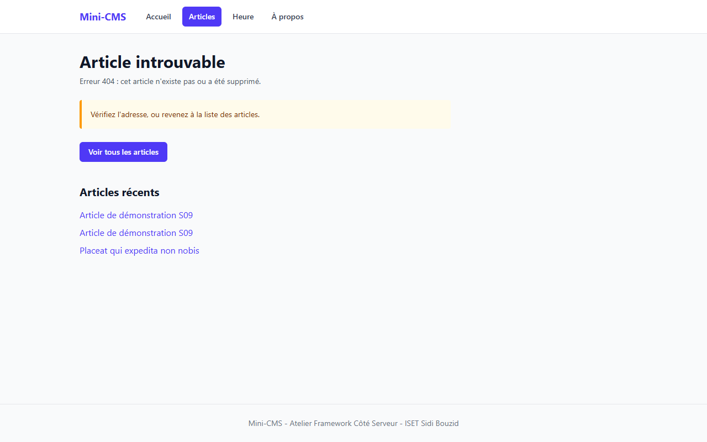

### Back-office et autorisations


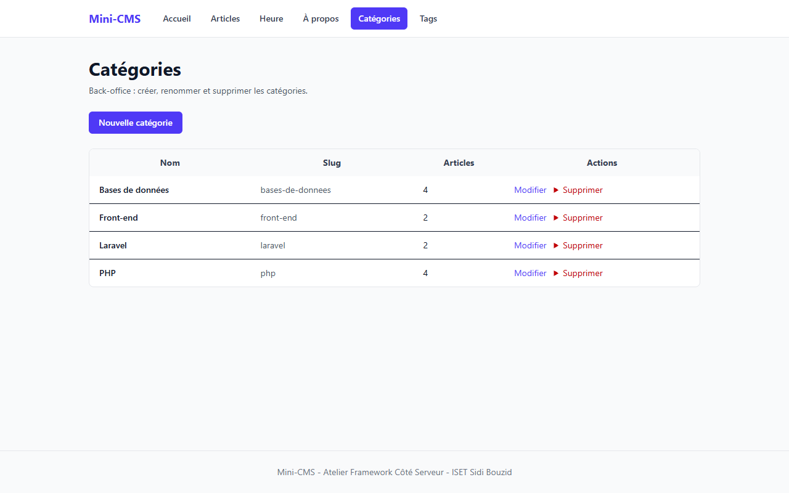


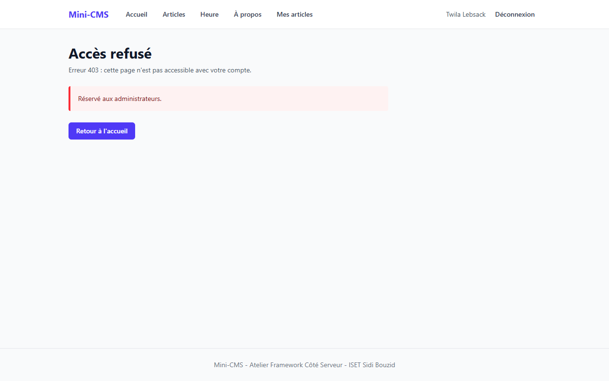

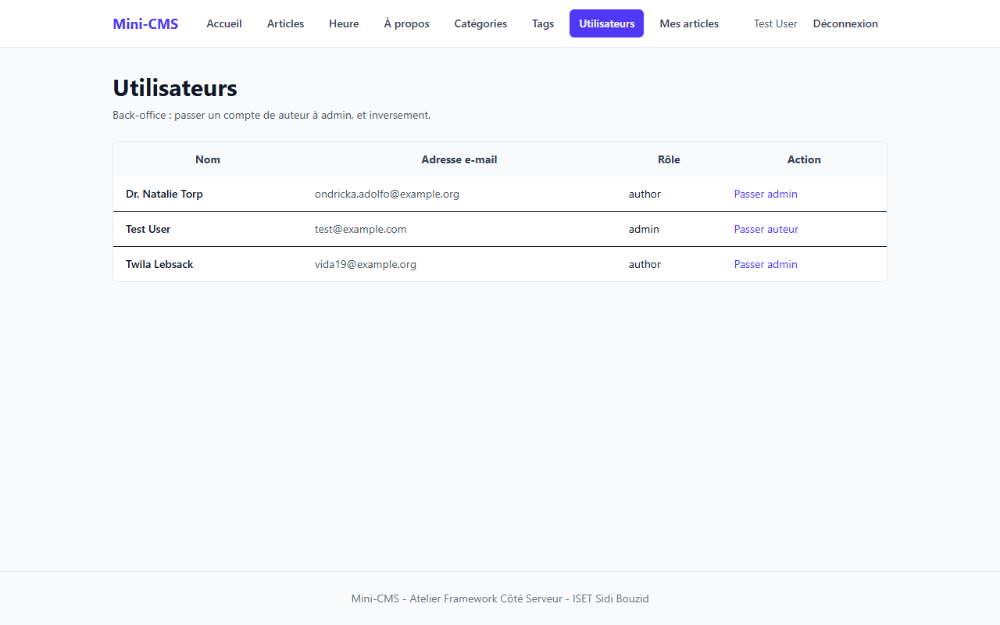

### API

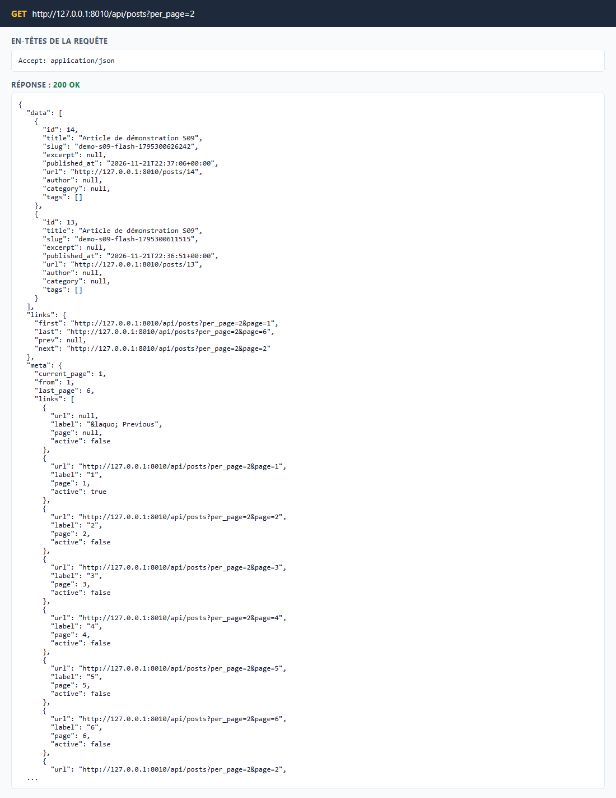

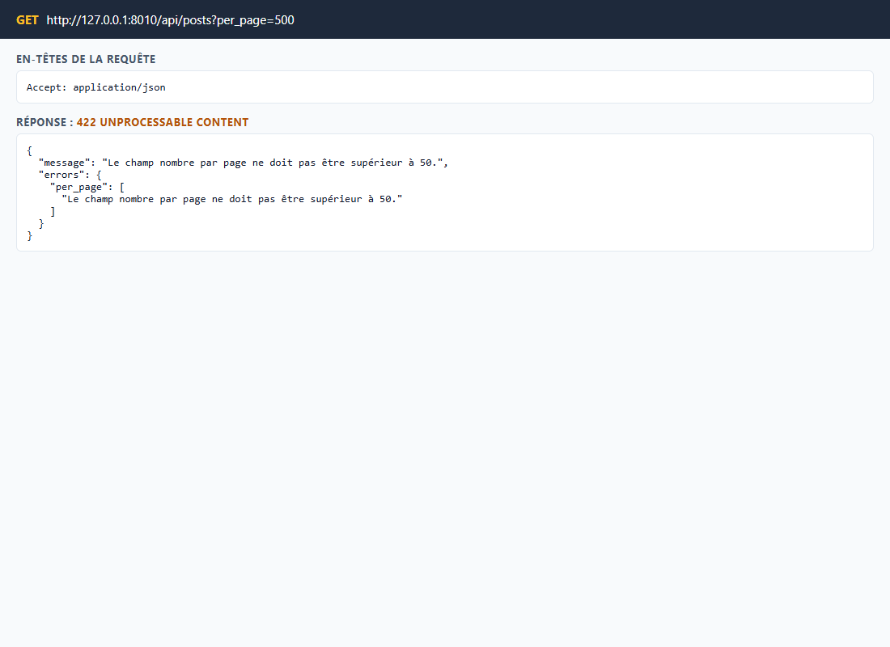

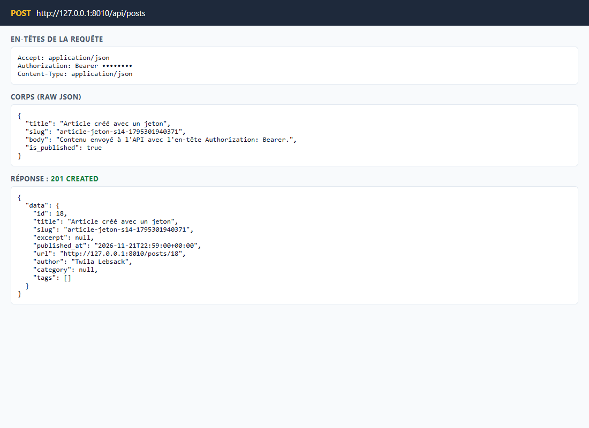

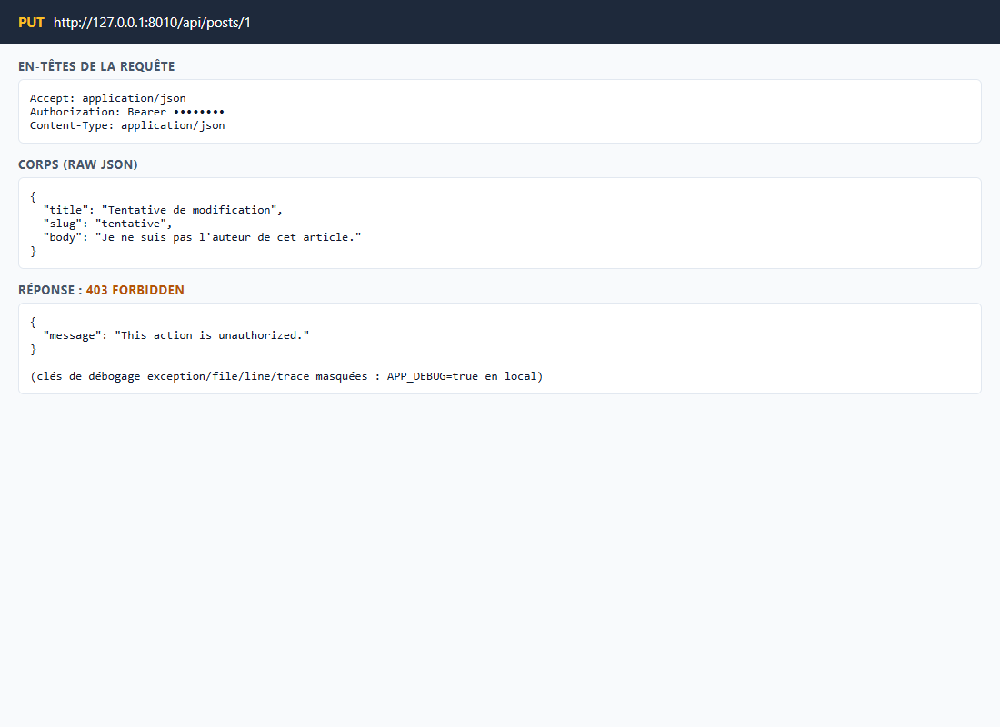

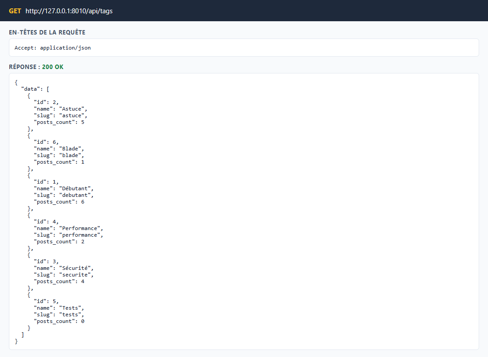

## Choix d'architecture

### Pourquoi les écritures de l'API passent par PostPolicy

Le site et l'API modifient les mêmes articles, donc ils doivent appliquer exactement la même règle : un auteur ne touche qu'à ses articles, un admin à tous. Cette règle est écrite une seule fois, dans `PostPolicy`. Le site l'utilise avec `Gate::authorize()` et `@can`, l'API avec `UpdatePostRequest::authorize()` et `Gate::authorize('delete', $post)`. Si la règle était recopiée dans le contrôleur de l'API, une correction faite d'un côté pourrait être oubliée de l'autre, et l'API deviendrait une porte dérobée. Le contrôle passe aussi avant la validation : un auteur qui envoie un formulaire vide sur l'article d'un autre reçoit 403, pas 422, ce qui ne révèle rien des règles de validation.

### Pourquoi preventLazyLoading est activé

`Model::preventLazyLoading(! app()->isProduction())` transforme un problème N+1 silencieux en exception visible pendant le développement et les tests. Sans lui, une vue ou une API Resource qui lit `$post->user` dans une boucle lancerait une requête SQL par article sans que personne ne le remarque. Avec lui, l'oubli d'un `with('user', 'category', 'tags')` casse immédiatement la page ou le test, et on corrige tout de suite. Il reste désactivé en production pour qu'un oubli ne provoque pas une erreur 500 chez un vrai visiteur. C'est aussi pour cela que les Resources utilisent `whenLoaded()` : c'est le contrôleur qui décide quoi charger.

### Pourquoi l'API utilise des jetons et non la session

Les routes du groupe `api` n'ont ni session ni cookie : elles sont sans état. Un client mobile, un script `curl.exe` ou Postman ne gèrent pas un cookie de session et un jeton CSRF comme un navigateur. Chaque requête porte donc sa preuve d'identité dans l'en-tête `Authorization: Bearer`. Un jeton Sanctum se révoque individuellement (`POST /api/logout` supprime seulement le jeton utilisé), sans déconnecter les autres appareils, et `Auth::attempt()` n'est pas utilisable sans session : la connexion vérifie donc le mot de passe avec `Hash::check()` puis crée le jeton avec `createToken()`.

## Comparaison avec le starter kit Livewire

| Critère | Mini-CMS (authentification manuelle) | Starter kit Livewire |
|---|---|---|
| Routes d'authentification | Écrites à la main dans `routes/web.php` (groupes `guest` et `auth`) | Fournies par Laravel Fortify (`/login`, `/register`, `/logout`...), pages en composants Livewire |
| Inscription | `Auth\RegisterController` + `RegisterRequest`, `Hash::make()` puis `Auth::login()` | Action Fortify `CreateNewUser` et page Livewire avec Flux |
| Connexion | `Auth\LoginController@store` : `Auth::attempt()`, `session()->regenerate()`, message neutre | Gérée par Fortify, même principe (tentative, régénération de la session) |
| Déconnexion | `LoginController@destroy` : `Auth::logout()`, `invalidate()`, `regenerateToken()` | Route `logout` de Fortify |
| Limitation des tentatives | Aucune | 5 tentatives par minute par e-mail et adresse IP (`FortifyServiceProvider`) |
| Mot de passe oublié | Absent | `Features::resetPasswords()` : e-mail de réinitialisation (journalisé avec `MAIL_MAILER=log`) |
| Vérification de l'e-mail | Absente | `Features::emailVerification()` et `MustVerifyEmail` sur `User` |
| Double authentification | Absente | `Features::twoFactorAuthentication()` (codes TOTP et codes de secours) |
| Rôles et autorisations | Colonne `role`, `User::isAdmin()`, middleware `EnsureUserIsAdmin`, Gates `manage-categories` et `manage-tags`, `PostPolicy` | Aucun rôle : à ajouter soi-même |
| Tests | `AuthTest`, `AuthorizationTest`, `AdminAccessTest`, `PostVisibilityTest` écrits à la main | Tests Pest fournis pour l'inscription, la connexion, la réinitialisation et la vérification |

Ce que je garderais du kit dans un vrai projet : la limitation des tentatives de connexion et la réinitialisation du mot de passe, parce qu'elles protègent les comptes et qu'elles sont faciles à mal écrire soi-même. Je garderais en revanche mes propres rôles, mon middleware `admin` et ma `PostPolicy`, puisque le kit ne gère pas les autorisations métier.

## Routes web

| Méthode | URI | Nom | Action |
|---|---|---|---|
| GET | `/` | `home` | `PageController@home` |
| GET | `/a-propos` | `about` | `PageController@about` |
| GET | `/heure` | `time` | `PageController@time` |
| GET | `/posts` | `posts.index` | `PostController@index` |
| GET | `/posts/archive/{year}` | `posts.archive` | `PostController@archive` |
| GET | `/posts/categorie/{category:slug}` | `posts.category` | `PostController@byCategory` |
| GET | `/posts/tag/{tag:slug}` | `posts.tag` | `PostController@byTag` |
| GET | `/posts/create` | `posts.create` | `PostController@create` |
| POST | `/posts` | `posts.store` | `PostController@store` |
| GET | `/posts/{post}` | `posts.show` | `PostController@show` |
| GET | `/posts/{post}/edit` | `posts.edit` | `PostController@edit` |
| PUT | `/posts/{post}` | `posts.update` | `PostController@update` |
| DELETE | `/posts/{post}` | `posts.destroy` | `PostController@destroy` |
| PATCH | `/posts/{post}/publication` | `posts.publication` | `PostController@togglePublication` |
| GET | `/mes-articles` | `my-posts` | `PostController@mine` |
| GET | `/inscription` | `register` | `Auth\RegisterController@create` |
| POST | `/inscription` | `register.store` | `Auth\RegisterController@store` |
| GET | `/connexion` | `login` | `Auth\LoginController@create` |
| POST | `/connexion` | `login.store` | `Auth\LoginController@store` |
| POST | `/deconnexion` | `logout` | `Auth\LoginController@destroy` |
| GET | `/admin/categories` | `admin.categories.index` | `CategoryController@index` |
| GET | `/admin/categories/create` | `admin.categories.create` | `CategoryController@create` |
| POST | `/admin/categories` | `admin.categories.store` | `CategoryController@store` |
| GET | `/admin/categories/{category}/edit` | `admin.categories.edit` | `CategoryController@edit` |
| PUT | `/admin/categories/{category}` | `admin.categories.update` | `CategoryController@update` |
| DELETE | `/admin/categories/{category}` | `admin.categories.destroy` | `CategoryController@destroy` |
| GET | `/admin/tags` | `admin.tags.index` | `TagController@index` |
| GET | `/admin/tags/create` | `admin.tags.create` | `TagController@create` |
| POST | `/admin/tags` | `admin.tags.store` | `TagController@store` |
| GET | `/admin/tags/{tag}/edit` | `admin.tags.edit` | `TagController@edit` |
| PUT | `/admin/tags/{tag}` | `admin.tags.update` | `TagController@update` |
| DELETE | `/admin/tags/{tag}` | `admin.tags.destroy` | `TagController@destroy` |
| GET | `/admin/utilisateurs` | `admin.users.index` | `UserController@index` |
| PATCH | `/admin/utilisateurs/{user}/role` | `admin.users.role` | `UserController@updateRole` |
